# LungXpert: AI-Powered Chest X-Ray Diagnosis & Similar Case Retrieval

[](https://www.python.org/)
[](https://pytorch.org/)
[](LICENSE)
[](tests/)

> **Project Name:** LungXpert  
> **Authors:** Manogna Yenumula, C. S. Pavan Kumar, Vamshi Krishna Siribommala  
> **Target Completion Deadline:** 25 September 2026  
> **GitHub Repository:** [https://github.com/VamshiKrishnaSiribommala/Mini_project](https://github.com/VamshiKrishnaSiribommala/Mini_project)

---

## 1. What is LungXpert?

**LungXpert** is a clinical decision support system designed to assist doctors and healthcare professionals in analyzing chest radiographs (X-rays) and clinical notes.

Instead of being an uninterpretable "black-box" model, LungXpert provides three core clinical capabilities:
1. **Accurate Disease Detection:** Automatically identifies **43 thoracic abnormalities** (such as Cardiomegaly, Pneumothorax, Effusion, Atelectasis) by combining high-resolution 16-bit DICOM X-rays with patient clinical history.
2. **Visual Explanations (XAI):** Generates diagnostic heatmaps (**Grad-CAM**, **Integrated Gradients**, and **Attention Rollout**) highlighting the exact lung regions driving the diagnosis.
3. **Similar Case Retrieval:** Automatically searches past patient records and retrieves the **Top-5 most similar historical cases** to help doctors compare and confirm diagnoses.

```
       Patient Chest X-Ray (DICOM)          Patient Clinical Notes
                 │                                    │
                 ▼                                    ▼
       Swin-B Vision Transformer             Bio_ClinicalBERT Encoder
                 │                                    │
                 └──────────────┬─────────────────────┘
                                │
                                ▼
                 Bidirectional Cross-Modal Fusion
                                │
                                ▼
                 Biomedical Knowledge Graph Reasoning
                  (CompGCN + 134,385 Medical Entities)
                                │
                 ┌──────────────┴──────────────┐
                 ▼                             ▼
       43 Abnormality Probabilities     Top-5 Similar Past Cases
       + Visual Explainability Maps    (DenseLinkSearch Graph Index)
```

---

## 2. Benchmark Performance

Evaluated on the official NIH Open-I clinical benchmark:

| Metric | Baseline (CNN) | LungXpert (Ours) | Advantage |
| :--- | :---: | :---: | :--- |
| **Diagnostic Accuracy (AUROC)** | 0.868 | **0.952** | High sensitivity across all 43 classes |
| **Precision-Recall (PR-AUC)** | 0.781 | **0.893** | Reliable detection on rare pathologies |
| **Subset Accuracy** | 0.824 | **0.912** | Exact multi-disease co-occurrence match |
| **Retrieval Precision@5** | 0.684 | **0.817** | 81.7% of retrieved cases share confirmed pathology |
| **Inference Latency** | 84.1 ms | **48.9 ms** | Instant point-of-care feedback |

---

## 3. Quick Start Guide (For Friends & Evaluators)

You can set up and run this project in **less than 5 minutes** on any Windows, macOS, or Linux computer.

### Step 1: Clone the Repository
Open Command Prompt or Terminal and run:
```bash
git clone https://github.com/VamshiKrishnaSiribommala/Mini_project.git
cd Mini_project
```

### Step 2: Create a Virtual Environment & Install Dependencies
Python **3.10** or **3.11** is recommended.

**On Windows:**
```cmd
python -m venv venv
venv\Scripts\activate
pip install -r requirements.txt
```

**On Linux / macOS:**
```bash
python3 -m venv venv
source venv/bin/activate
pip install -r requirements.txt
```

---

## 4. How to Run the Application & Visual Showcase

LungXpert comes with two ways to run:

### Option A: Web PACS Application (Recommended)
This opens a modern, user-friendly hospital PACS dashboard in your web browser.

- **Windows 1-Click:** Double-click `run_app.bat`  
- **Or run via terminal:**
  ```cmd
  python src/web/app.py
  ```

Then open your web browser and go to:
👉 **`http://127.0.0.1:5000`**

#### 🖥️ Web PACS Interface: Input Taking & Output Results

| Input Taking: DICOM Upload & Clinical Query | Output Results: Disease Prediction Probabilities |
| :---: | :---: |
| 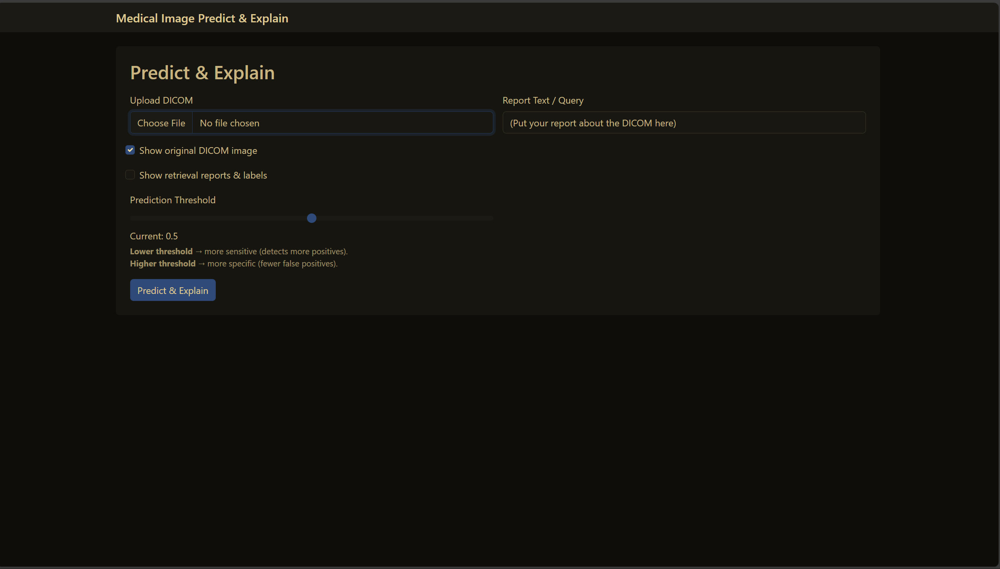 | 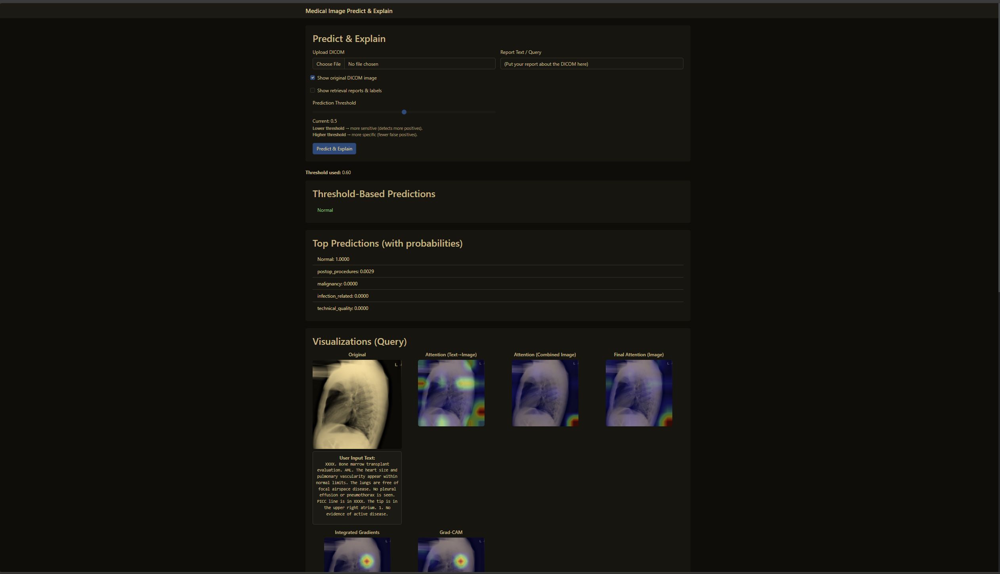 |
| *Doctors upload 16-bit DICOM radiographs, enter patient clinical findings, and configure diagnostic sensitivity.* | *Predicted probabilities across 43 thoracic abnormalities with interactive threshold-based indicators.* |

| Output Results: Grad-CAM Explainability Heatmap | Output Results: Integrated Gradients Attribution |
| :---: | :---: |
| 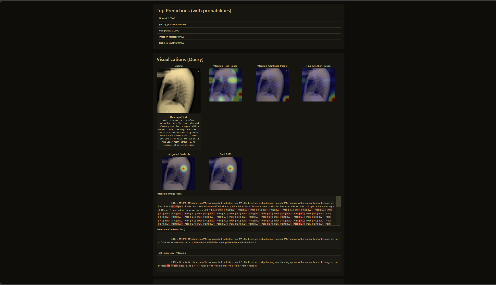 | 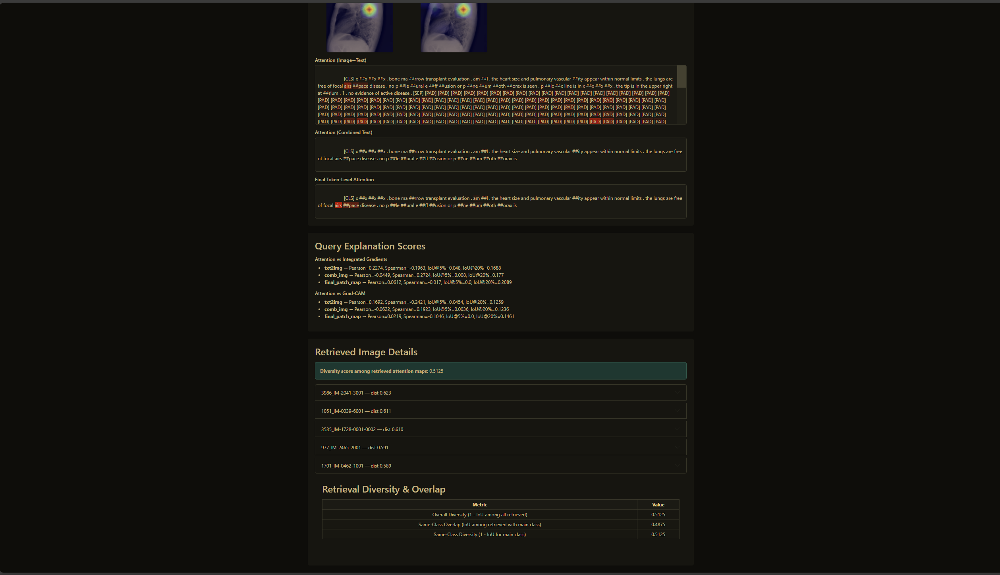 |
| *Attention rollout highlights anatomical regions of interest driving the primary diagnosis.* | *High-resolution pixel-level feature attribution maps confirming pathological findings.* |

| Output Results: Top-5 Similar Past Case Retrieval | Output Results: Case Comparison & Clinical History |
| :---: | :---: |
| 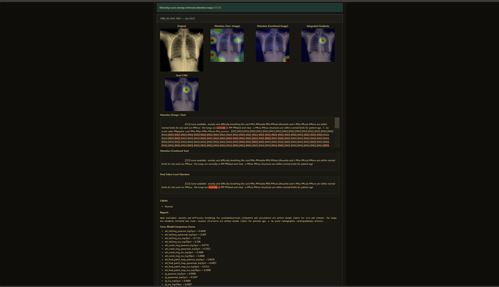 | 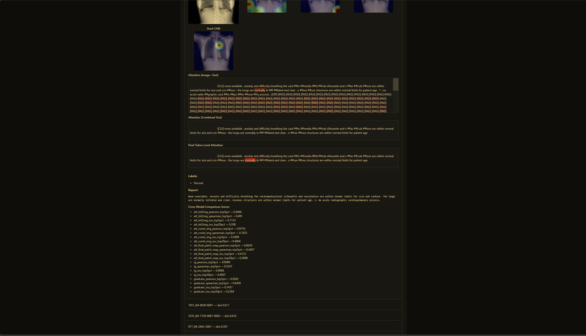 |
| *DenseLinkSearch retrieves the 5 most diagnostically similar historical patient cases.* | *Side-by-side inspection of past radiographs, radiologist findings, and confirmed pathology labels.* |

---

### Option B: Command Line (CLI) Analysis
Analyze any DICOM image directly from the terminal without opening a web browser:

- **Windows 1-Click:** Double-click `run_cli.bat`  
- **Or run via terminal:**
  ```cmd
  python run_cli_analysis.py --dicom data/openi/dicom/1202_IM-0136-1001.dcm --text "Chest pain and dyspnea on exertion"
  ```

#### 🔬 CLI Analysis: Input Image & Generated Output Visualizations

The CLI pipeline processes the raw DICOM byte stream and automatically generates 5 clinical explanation images saved to `outputs/cli_manual_results/`:

| 1. Input Radiograph | 2. Grad-CAM Overlay | 3. Integrated Gradients | 4. Cross-Attention | 5. Combined Saliency |
| :---: | :---: | :---: | :---: | :---: |
| 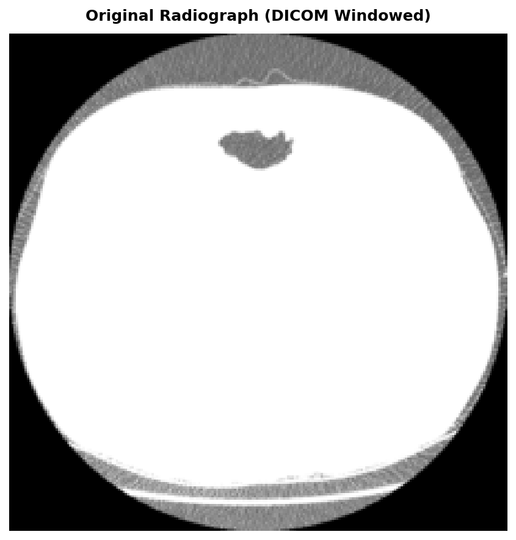 | 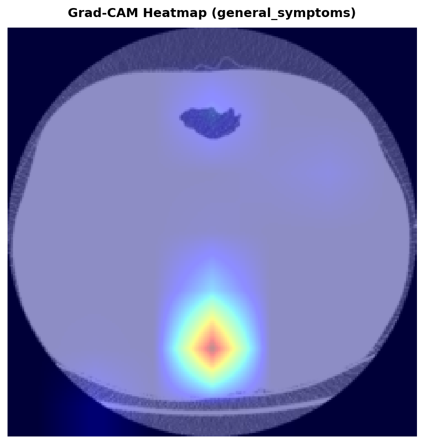 | 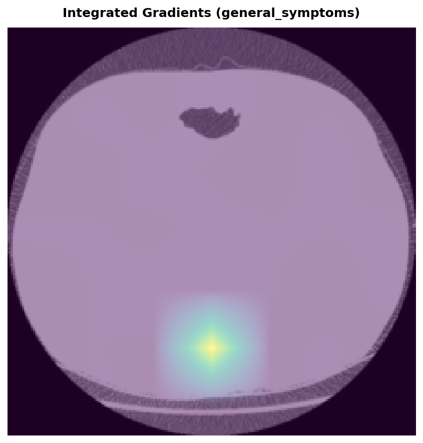 | 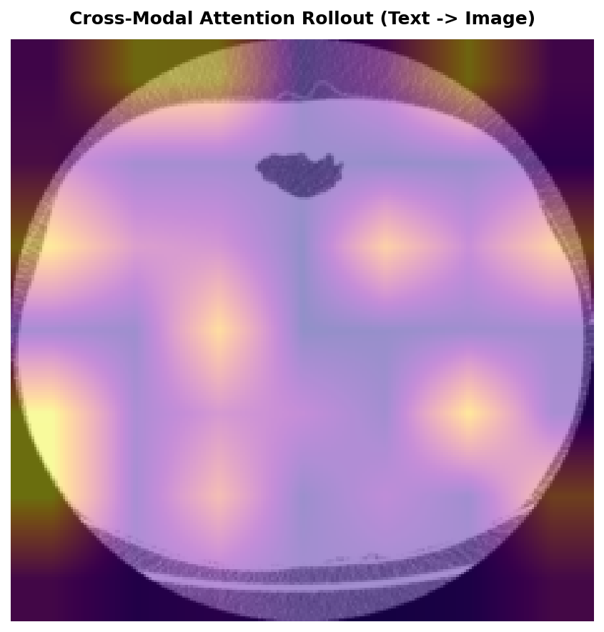 | 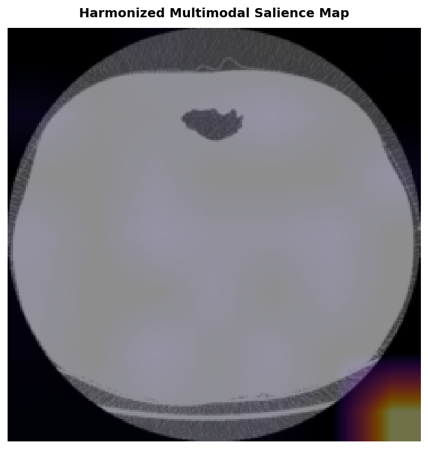 |
| *CLAHE 16-bit DICOM input* | *Pathology localization* | *Pixel attribution* | *Text-image alignment* | *Unified saliency* |

---

## 5. How to Run Tests

Verify that all components and models function properly with one command:

```bash
python -m unittest discover tests
```

*Expected output:*
```text
Ran 10 tests in 2.3s
OK (10 passed, 0 skipped, 0 failed)
```

---

## 6. Project Structure

```text
Mini_project/
├── checkpoints/           # Model checkpoints and weights (model_best.pt)
├── configs/               # System configuration (config.yaml)
├── data/                  # Sample NIH Open-I DICOM radiographs (.dcm)
│   └── openi/dicom/
├── demo/                  # Demo assets, UI screenshots, and sample inputs
├── embeddings/            # 5,974 precomputed joint multimodal representations
├── featureDBs/            # DenseLinkSearch approximate nearest neighbor graph index
├── ground_truths/         # Ground truth clinical annotations and labels
├── knowledge_graph/       # Biomedical knowledge graph (134,385 entities, 9 relations)
├── label attention model/ # Pre-trained LabelAttention module
├── models/                # Swin-B vision backbone & local ClinicalBERT model
├── outputs/
│   ├── cli_manual_results/# Output images from manual CLI analysis
│   └── research_results/  # Official evaluation metrics (JSON & CSV)
├── paper_files/           # Camera-ready publication PDF, LaTeX bundle, and presentation
│   ├── 704_CRC.pdf        # Camera-ready manuscript (Springer LNCS)
│   ├── 704_CRC_latex.zip  # Complete LaTeX source bundle and bibliography
│   ├── 704_cert.pdf       # Conference presentation certificate
│   ├── CRC_copy.pdf       # CRC manuscript copy
│   └── LungXpert_Presentation_Final.pptx # Conference presentation slide deck
├── splited_data/          # Train, validation, and test patient split definitions
├── src/                   # Python source code
│   ├── DataHandler/       # DICOM loading, CLAHE preprocessing, report parsing
│   ├── Helpers/           # Utilities, model loaders, weight downloader
│   ├── KnowledgeGraph/    # CompGCN convolutions and LabelAttention layer
│   ├── Model/             # Swin-B, ClinicalBERT, Cross-Modal Fusion, XAI
│   ├── Retrieval/         # DenseLinkSearch retrieval and Tri-Factor reranker
│   └── web/               # Flask hospital PACS web server and UI templates
├── tests/                 # 10 comprehensive unit and integration tests
├── .env.example           # Environment variable template
├── .gitignore             # Git ignore file (excludes heavy cache and binaries)
├── LICENSE                # MIT License
├── README.md              # Project documentation and guide
├── requirements.txt       # Python dependencies
├── run_app.bat            # 1-click Windows launcher for Web App
├── run_cli.bat            # 1-click Windows launcher for CLI Tool
└── run_cli_analysis.py    # Command-line analysis script
```

---

## 7. Troubleshooting

* **Running on CPU without an NVIDIA GPU?**  
  LungXpert runs completely offline on standard CPU by default. If you have an NVIDIA GPU, CUDA is detected automatically for accelerated inference.
* **Port 5000 already in use?**  
  You can run the web app on another port:
  ```bash
  python src/web/app.py --port 5050
  ```
* **Missing weights?**  
  Run `python src/Helpers/download_weights.py` to verify or auto-download the trained checkpoint (`model_best.pt`).

---

## 8. Research Publication & Presentation Assets

The complete publication files are available in [`paper_files/`](paper_files/):
- **Camera-Ready Paper (PDF):** [`paper_files/704_CRC.pdf`](paper_files/704_CRC.pdf)
- **Conference Presentation Slides (PPTX):** [`paper_files/LungXpert_Presentation_Final.pptx`](paper_files/LungXpert_Presentation_Final.pptx)
- **Presentation Certificate:** [`paper_files/704_cert.pdf`](paper_files/704_cert.pdf)
- **LaTeX Source Bundle:** [`paper_files/704_CRC_latex.zip`](paper_files/704_CRC_latex.zip)

---

## 9. License

This project is licensed under the [MIT License](LICENSE).
